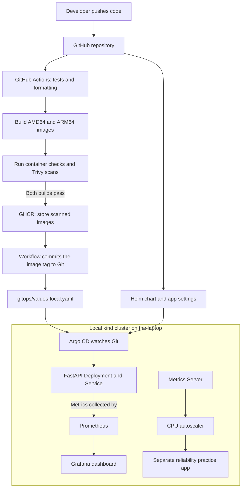
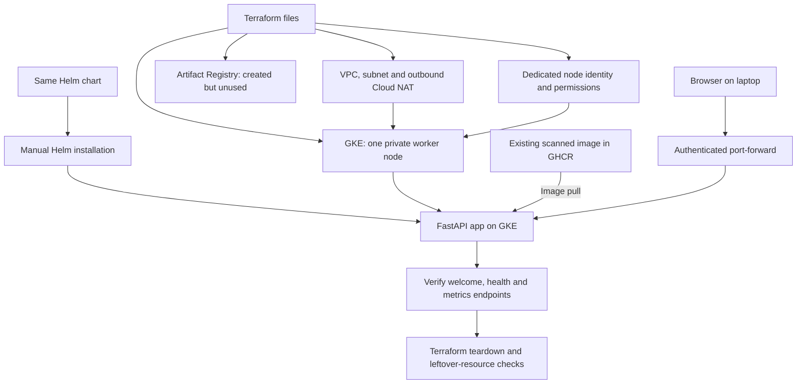

# How the pieces fit together

[Back to the project](../README.md)

The project has two deployment paths. The local setup demonstrates automatic
delivery from Git. The GCP exercise used the same app and Helm chart to verify
that the service also runs on a real cloud cluster.

## Everyday development: automatic local deployment

The image tag identifies its source commit. Publication uses the same images
that passed the checks. If a newer source commit has arrived, an older workflow
skips promotion instead of overwriting the newer configuration.

Argo CD uses Helm to produce Kubernetes configuration and then manages that
configuration itself. It can sync configuration changes before CI finishes;
image promotion is the step that waits for passing tests and scans.

The main app uses a fixed replica count. CPU autoscaling was tested separately
with one to three pods. Metrics Server supplies HPA's CPU readings; Prometheus
supplies the Grafana dashboard. They serve different purposes.

## GCP practice: provision, deploy, test, delete

This exercise used a single `e2-standard-2` worker in `us-central1-a`, with
2 vCPUs, 8 GB RAM, and a 30 GB balanced disk. The worker had no public IP.
The Kubernetes API accepted access from one administrator IPv4 address.

The browser used a local tunnel to reach the cloud app. There was no public
load balancer. Argo CD and the Grafana stack were not installed in GKE for this
exercise, and images continued to come from GHCR.

**The cloud environment was deleted after testing on October 12, 2026.**
The screenshots document the successful deployment at that time; they are not
an indication that it is still running.

## What this demonstrates

- Repeatable builds and checks before publishing an image.
- Git-based deployment and correction of manual configuration drift locally.
- Monitoring and practical scaling, recovery, and rollback exercises.
- Creating real GCP infrastructure with Terraform and reusing the app chart.
- Cleaning up a temporary cloud environment after verification.

This is a learning platform. One node is not a highly available production
setup, and the tests do not establish a production performance or uptime claim.

See [cloud screenshots and results](../gcp/RESULTS.md) and
[local reliability results](../reliability/RESULTS.md).
