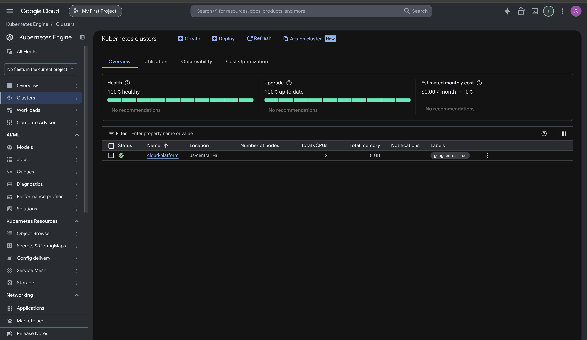
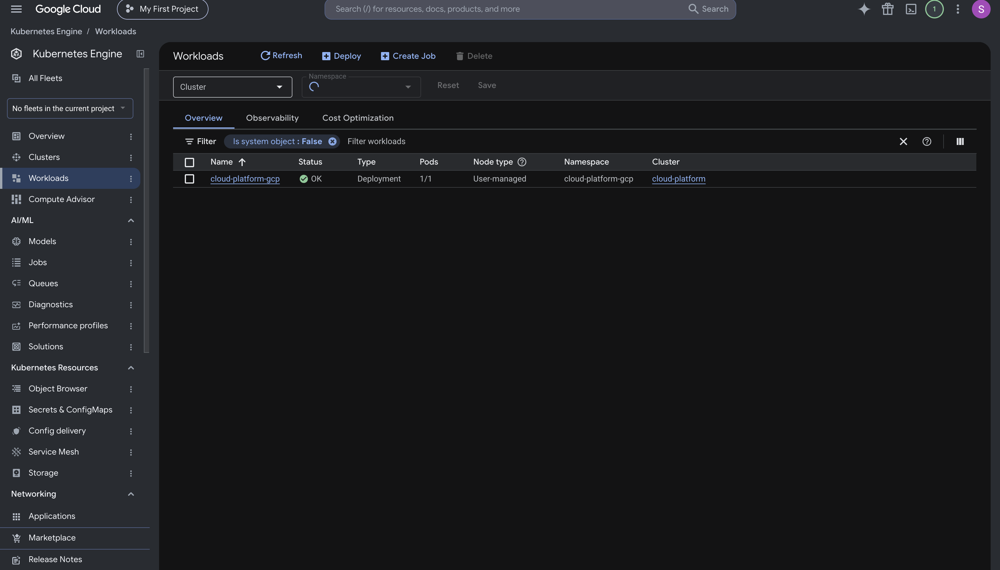

# GCP verification — October 12, 2026

The Terraform-managed `cloud-platform` cluster in `us-central1-a` was created and tested.
Its single `e2-standard-2` worker was Ready on Kubernetes v1.35.8-gke.1225000,
with a 30 GB balanced disk and private node networking.

Helm installed release `cloud-platform-gcp`, revision 1, in its own namespace.
The image came from GHCR with source tag
`sha-d9fad7353d682a07f560e21cc73f2336960f509d`.

Verified through an authenticated localhost port-forward to GKE:

- `/`: HTTP 200, expected welcome message.
- `/health`: HTTP 200, `{"status":"healthy"}`.
- `/metrics`: HTTP 200, expected Prometheus request counter.
- App pod: 1/1 Ready with no restarts at verification time.

This cloud installation was managed directly by Helm. Argo CD and the
Grafana monitoring stack were kept in the local kind cluster. An Artifact Registry
repository was created, but the app pulled from GHCR. No public load balancer was created.

## Cleanup completed — October 12, 2026

After hands-on testing, the practice environment was deleted. Terraform completed teardown
of all 15 managed entries, and its state is empty. Project service APIs were
removed from state but remain enabled, as configured by `disable_on_destroy=false`.

A separate read-only GCP inventory check confirmed no clusters, VMs, disks,
reserved IPs, routers/NAT, forwarding rules, managed instance groups, instance
templates, or Artifact Registry repositories remained. The dedicated node service
account was also absent. Only the pre-existing default VPC, its subnets, and its
four default firewall rules remain in the network inventory.

The cloud browser tunnel is closed. The source files, local Kubernetes setup,
and test results are preserved. The GCP project and billing account were not
deleted. Billing reports may still show charges accrued before cleanup.

## Screenshots from the successful deployment

### Healthy GKE cluster

One worker with 2 vCPUs and 8 GB RAM in `us-central1-a`.

### Application ready

The `cloud-platform-gcp` Deployment shows status OK and 1/1 pods ready.

These screenshots were captured before teardown. The console's displayed cost
estimate is not a final bill or evidence of free operation.

[See the architecture](../docs/architecture.md) · [Back to the project](../README.md)
